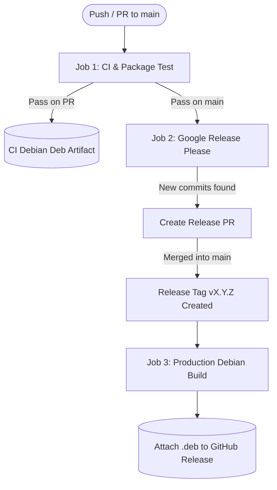

# Knobu CI/CD & Automated Release Pipeline

Documentation and architectural specifications for Knobu's Continuous Integration, Debian packaging gate, Semantic Versioning, and production release delivery pipelines on GitHub Actions.

---

## 1. Pipeline Architecture Overview

The automated workflow is consolidated inside [`.github/workflows/ci.yml`](file:///home/surya-prakash/Documents/surya-personal/src-code/knobu/.github/workflows/ci.yml) and executes across three sequential jobs:



> [!TIP]
> An interactive, responsive standalone HTML architecture diagram is compiled at [`.github/cicd-workflow.html`](file:///home/surya-prakash/Documents/surya-personal/src-code/knobu/.github/cicd-workflow.html) with dark/light themes, relationship tracing, and zoom controls.

---

## 2. Jobs Breakdown

### Job 1: `ci` (Lint, Test & Build Deb)
- **Environment**: `ubuntu-24.04`
- **Trigger**: Every pull request targeting `main` and direct pushes to `main`.
- **Purpose**: Strict quality gate ensuring the package builds, passes all unit tests, and verifies runtime installation.
- **Key Steps**:
  1. **Dependencies Installation**:
     ```bash
     sudo apt-get install -y --no-install-recommends \
       build-essential \
       debhelper-compat \
       dh-sequence-python3 \
       pybuild-plugin-pyproject \
       python3-all \
       python3-setuptools \
       python3-evdev \
       python3-gi \
       gir1.2-gtk-4.0 \
       gir1.2-adw-1
     ```
  2. **Package Build & Test Suite**:
     - Runs `dpkg-buildpackage -us -uc -b`.
     - Automatically executes all 54 unittests under `tests/` during the pybuild test step (`override_dh_auto_test` in `debian/rules`) across all 7 core modules (Touchpad Gestures, Keyboard Manager, Awake, Color Picker, Text Extractor, Clipboard History, and Command Bar).
     - Moves generated debian files into a workspace-local `dist/` directory (`dist/*.deb`).
  3. **Package Verification**:
     - Installs `./dist/knobu_*_all.deb` using `apt-get`.
     - Executes `knobu --version` and `knobu --help`.
  4. **Artifact Archiving**:
     - Uploads `dist/*.deb` as a workflow artifact retained for 14 days.

---

### Job 2: `release-please` (Evaluate Semantic Release)
- **Environment**: `ubuntu-latest`
- **Trigger**: Runs exclusively on pushes to `main` after Job 1 (`ci`) succeeds.
- **Engine**: `googleapis/release-please-action@v4` using the `python` release type strategy.
- **Configuration**:
  - [`release-please-config.json`](file:///home/surya-prakash/Documents/surya-personal/src-code/knobu/release-please-config.json):
    - `bump-minor-pre-major: true` (ensures `feat:` increments minor version `0.x.0`).
    - `changelog-path: "CHANGELOG.md"`
  - [`.release-please-manifest.json`](file:///home/surya-prakash/Documents/surya-personal/src-code/knobu/.release-please-manifest.json): tracks the current released version.
- **Actions**:
  - Scans Git history for [Conventional Commits](https://www.conventionalcommits.org/) (`feat:`, `fix:`, `chore:`, `perf:`).
  - Automatically opens or appends to a release PR titled `chore(main): release X.Y.Z`.
  - When the PR is merged by a maintainer, Release Please creates the GitHub Release and tags the repository `vX.Y.Z`.

---

### Job 3: `build-release` (Build & Attach Production Deb)
- **Environment**: `ubuntu-24.04`
- **Trigger**: Executes automatically when `release-please` outputs `release_created: true`.
- **Purpose**: Produces an immutable, production Debian package tied to the release tag and attaches it directly to the GitHub Release.
- **Key Steps**:
  1. Checks out the tagged commit (`ref: vX.Y.Z`).
  2. Installs `build-essential` and Debian build toolchains.
  3. Formats and stamps the official Debian changelog version via `debian/changelog`.
  4. Runs `dpkg-buildpackage -us -uc -b` and stages `dist/knobu_<version>_all.deb`.
  5. Uploads the package asset to the GitHub Release using `gh release upload "$TAG_NAME" dist/*.deb --clobber`.
  6. Archives the release artifact for 90 days.

---

## 3. Important Pipeline Best Practices & Troubleshooting

### Node.js Deprecation Warning Suppression
In `.github/workflows/ci.yml`, the workflow defines:
```yaml
env:
  NODE_OPTIONS: "--no-deprecation"
```
This silences noisy Node.js 20 runtime deprecation logs (`[DEP0040] punycode module is deprecated`) emitted by marketplace JavaScript actions without suppressing genuine errors.

### Relative Pathing in Artifact Uploads
`actions/upload-artifact@v4` strictly forbids paths referencing parent directories (`../`). Debian packages generated by `dpkg-buildpackage` are copied into `dist/` before invoking `upload-artifact`:
```bash
dpkg-buildpackage -us -uc -b
mkdir -p dist
cp ../knobu_*_all.deb dist/
```
The artifact upload path is set to `dist/*.deb`.

### GitHub Actions Pull Request Permissions
For `release-please` to open release PRs, ensure repository workflow permissions are enabled:
1. Navigate to **Settings** > **Actions** > **General** on GitHub.
2. Under **Workflow permissions**, check **Allow GitHub Actions to create and approve pull requests**.
3. Save settings.

---

## 4. End-User Installation & Upgrade Runbook

When a new version tag (`vX.Y.Z`) is published, end users can install or upgrade Knobu directly from GitHub Releases:

### Fast Terminal Upgrade
```bash
# 1. Download the latest release package
wget $(curl -s https://api.github.com/repos/Aries-Surya/knobu/releases/latest | grep "browser_download_url.*deb" | cut -d '"' -f 4) -O /tmp/knobu_latest.deb

# 2. Upgrade without touching user configuration or databases
sudo apt install --reinstall /tmp/knobu_latest.deb

# 3. Restart the background user service
systemctl --user restart knobu.service

# 4. Verify version
knobu --version
```

### GitHub CLI Upgrade
```bash
gh release download --repo Aries-Surya/knobu --pattern "*.deb" --dir /tmp --clobber
sudo apt install --reinstall /tmp/knobu_*_all.deb
systemctl --user restart knobu.service
knobu --version
```


